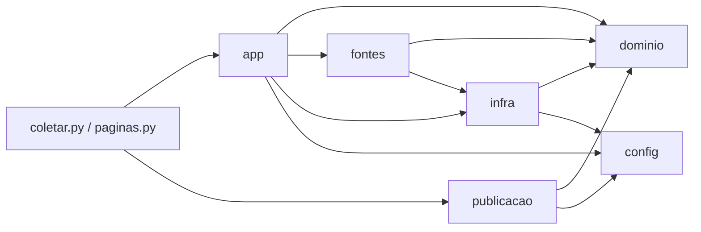

# Arquitetura · NaPlanta

Arquitetura limpa na medida do projeto: **camadas com dependência num sentido só**, regras de negócio puras e testáveis, e infraestrutura trocável. Sem banco e sem servidor: o "backend" é uma coleta em lote que publica JSON estáticos.

## Estrutura de pastas

```
coleta/                              backend em lote (Python 3.12)
  coletar.py                         ponto de entrada: coleta diária (Actions e local.ps1)
  paginas.py                         ponto de entrada: páginas e sitemap (job publicar)
  local.ps1                          agendamento da coleta no PC do projeto
  requirements.txt
  cache/                             dados de apoio versionados (não é código)
    geo.json                         respostas do Nominatim
    arredores.json                   estação e serviços por coordenada
  naplanta/
    config.py                        caminhos, URL do site, fuso, User-Agents
    dominio/                         regras puras: sem rede, sem disco
      empreendimento.py              limpeza, validação, etapa e tipo
      mudancas.py                    comparação entre coletas, quedas, histórico
      texto.py                       slug, menção ao MCMV
      coordenadas.py                 geohash, ponto dentro do Brasil
    fontes/                          adaptadores: um por incorporadora (BASE + coletar())
      __init__.py                    registro FONTES
      helbor.py · cury.py · tenda.py · ...
    infra/                           mundo externo
      rede.py                        HTTP com robots.txt, identificação e pausa
      geo.py                         Nominatim: confere e corrige posição
      arredores.py                   Overpass: estação e serviços
      fotos.py                       miniaturas WebP
      repositorio.py                 leitura e gravação dos JSON do site
    app/
      coleta_diaria.py               caso de uso: orquestra fontes, domínio e infra
    publicacao/
      paginas.py                     HTML por empreendimento, lista e sitemap

site/                                front-end estático (GitHub Pages)
  index.html · transparencia.html
  dados.json · mudancas.json · status.json · fotos/      gerados pela coleta
  e/ · sitemap.xml                                       gerados na publicação (fora do git)
  js/
    main.js                          composição: liga as peças e coordena o render
    dados.js                         busca os JSON
    nucleo/                          regras puras: sem DOM, sem Leaflet
      filtros.js                     filtrar, ordenar, contar filtros ativos
      situacao.js                    "atualizado hoje", fontes paradas, eventos recentes
      formato.js · etapas.js
    ui/                              componentes de tela, cada um dono do seu pedaço do DOM
      mapa.js                        único módulo que fala com o Leaflet
      lista.js                       cards sob demanda e rolagem progressiva
      painel-filtros.js · cabecalho.js · novidades.js · boas-vindas.js
      modelos.js                     HTML do card e do popup (com escape)
    transparencia.js
```

## Regra de dependência



- **`dominio`** não importa nada do projeto. Só usa a biblioteca padrão, e cada regra tem autoteste com `assert`.
- **`fontes`** dependem só de `infra.rede` (para respeitar o `robots.txt`) e de regras do domínio.
- **`infra`** é a única camada que faz rede ou disco. O caso de uso não conhece caminhos nem HTML.
- **`config`** é o único lugar com caminhos e constantes do ambiente.
- No front: **`nucleo`** não toca no DOM, **`ui`** não decide regra de negócio, e **`main.js`** só compõe.

## Fluxo da coleta (caso de uso)

1. `repositorio.ler()` traz a coleta anterior, o histórico e o status.
2. Para cada fonte: `fonte.coletar()` → `limpo` → `problemas` → `etapa` e `tipo` → `conferir_volume`. Se a fonte falha, mantém os dados anteriores dela.
3. `comparar()` gera os eventos do dia.
4. `geo` → `arredores` → `fotos` enriquecem os dados.
5. `repositorio.gravar()` salva dados, histórico e status.

## Fluxo da tela

`main.render()`: `painel.ler()` → `filtrar` + `ordenar` (núcleo) → `cabecalho.atualizar` → `mapa.montar` + `lista.montar` → `mapa.enquadrar`.

Interações:
- **Pino:** `lista.marcar`.
- **Card:** `abrir` (mapa e lista).
- **Novidade ou link `?e=`:** `focar`. Se os filtros escondem o empreendimento, mostra a cidade dele com tudo.

## Como estender

| Quero... | Mexo em... |
|---|---|
| Nova incorporadora | `naplanta/fontes/<nome>.py` e o registro em `fontes/__init__.py` |
| Nova regra de validação | `dominio/empreendimento.py` (com `assert`) |
| Trocar onde os dados são gravados (banco, por exemplo) | só `infra/repositorio.py` |
| Novo filtro | `nucleo/filtros.js` (regra), `painel-filtros.js` e `index.html` (campo) |
| Trocar o Leaflet | só `ui/mapa.js` |

## Como a refatoração foi verificada (comportamento inalterado)

- **Páginas e sitemap:** as 904 páginas e o `sitemap.xml` gerados antes e depois são idênticos byte a byte.
- **Coleta:** a versão antiga e a nova rodaram com as mesmas fontes falsas, cobrindo dado válido, campo inválido, falha, resposta vazia, queda, queda aceita após 3 coletas e saídas. `dados.json`, `mudancas.json`, `status.json` e o log saíram idênticos.
- **Site:** 21 verificações (filtros, as 4 ordenações, rolagem, agrupamento, pino, card, HTML do card e do popup, novidades) rodaram na versão antiga e na nova, com resultados idênticos. Também foram verificados o link `?e=`, a primeira visita, o celular e a página "Sobre os dados".
